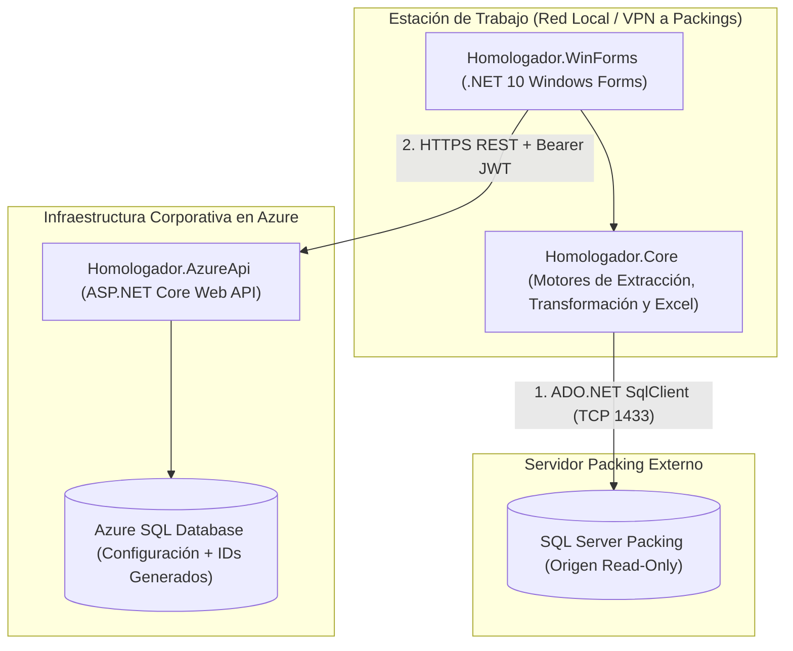
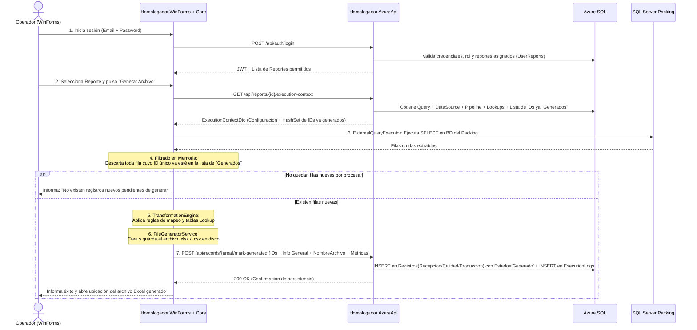
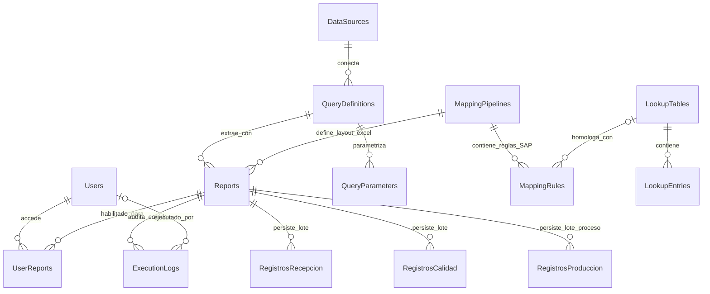
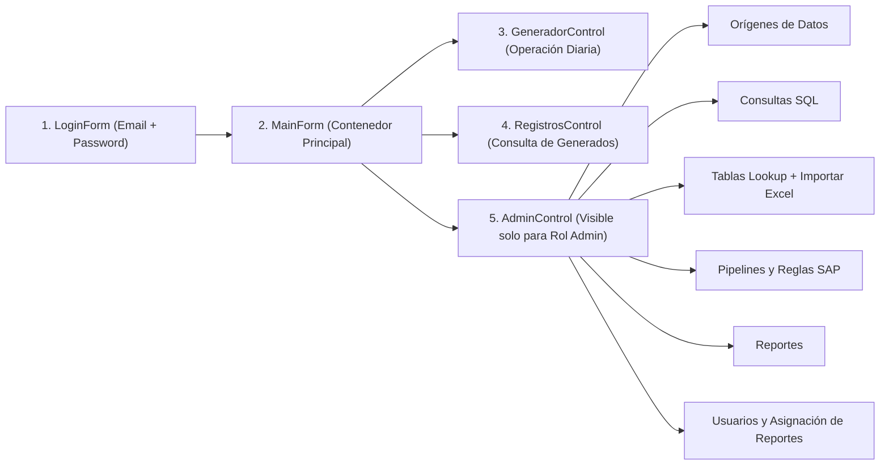

# Documento de Diseño Técnico (SDD) — Simplificación y Migración a Windows Forms + API Azure

| Atributo | Detalle |
| :--- | :--- |
| **Proyecto** | Homologador de Packings Externos (DDC) |
| **Ubicación de trabajo** | `\Migración` |
| **Objetivo** | Simplificar la arquitectura eliminando Angular/WebView2 y la gestión de estados intermedios/JSON, migrando la interfaz a **Windows Forms (.NET 10)** y centralizando la configuración, seguridad y control de IDs generados en **Azure (API + Azure SQL)**. |
| **Principio Rector** | Código mínimo, justificado, mantenible y sostenible, reutilizando el núcleo probado del backend actual. |

---

## 1. Resumen Ejecutivo y Cambio de Paradigma

La versión anterior del sistema operaba como una plataforma de revisión previa con múltiples estados (`Pendiente`, `Generado`, `Publicado/Cargado en SAP`, `Anulado`, `Modificado post-carga`), lotes temporales en borrador (`ExportBatches`), almacenamiento completo de filas en formato JSON (`DataJson`) y generación dinámica de vistas SQL (`rpt.*`).

El nuevo diseño establece un flujo **directo, determinista y sin almacenamiento redundante**:

1. **La fuente de verdad** de los datos operativos sigue siendo la base de datos de origen (SQL Server del packing externo).
2. **El respaldo físico** de cada exportación es el archivo Excel/CSV generado por DDC.
3. **La base de datos en Azure** almacena únicamente:
   * Seguridad, usuarios, perfiles (`Recepción`, `Calidad`, `Producción`) y asignación de reportes por usuario (`UserReports`).
   * Configuraciones técnicas (conexiones a packings, consultas SQL, tablas de equivalencia *Lookups*, pipelines de mapeo y definición de reportes).
   * Trazabilidad mínima en **3 tablas relacionales de negocio** (`RegistrosRecepcion`, `RegistrosCalidad`, `RegistrosProduccion`) junto con la bitácora de ejecuciones (`ExecutionLogs`).
4. **Ciclo único de operación**:
   * **Primera ejecución**: Extraer información del packing $\rightarrow$ Transformar $\rightarrow$ Generar archivo Excel $\rightarrow$ Registrar IDs exportados con estatus `'Generado'` $\rightarrow$ **FIN**.
   * **Siguientes ejecuciones**: Extraer información del packing $\rightarrow$ Omitir los IDs que ya existen con estatus `'Generado'` $\rightarrow$ Transformar solo los nuevos $\rightarrow$ Generar archivo Excel $\rightarrow$ Registrar los nuevos IDs como `'Generado'` $\rightarrow$ **FIN**.

---

## 2. Auditoría del Backend Actual (Reutilización y Podado)

Se auditó el código existente en `backend/src/DataHomologator.*` para separar los motores reutilizables de la complejidad que se descarta:

| Componente Actual | Acción | Destino en `\Migración` | Justificación Técnica |
| :--- | :---: | :--- | :--- |
| `ExternalQueryExecutor.cs` | **Reutilizar intacto** | `Homologador.Core` | Ejecuta consultas SQL parametrizadas de solo lectura (`SqlClient`) contra los servidores de los packings externos. |
| `SqlConnectionTester.cs` | **Reutilizar intacto** | `Homologador.Core` | Valida conectividad hacia las bases de datos de los packings desde la estación de trabajo. |
| `TransformationEngine.cs` | **Reutilizar intacto** | `Homologador.Core` | Motor en memoria que aplica las reglas (`Direct`, `Fixed`, `Lookup`, `DateFormat`, `Substring`, `Concat`, `Conditional`). |
| `FileGeneratorService.cs` | **Reutilizar intacto** | `Homologador.Core` | Construye el archivo `.xlsx` (ClosedXML) o `.csv` con el formato requerido por SAP. |
| `EncryptionService.cs` | **Reutilizar intacto** | `Homologador.Core` | Cifrado y descifrado AES-256 de cadenas de conexión de los packings. |
| `AuthService.cs` y `UserManagementService.cs` | **Conservar** | `Homologador.AzureApi` | Mantiene el login JWT, perfiles de usuario y control de acceso por reporte (`UserReports`). |
| `DataSourceService`, `QueryEngineService`, `LookupTableService`, `MappingPipelineService`, `ReportService` | **Simplificar** | `Homologador.AzureApi` | Se conservan los ABM y la importación Excel de Lookups; se elimina el flujo Borrador/Oficial, la herencia de registros y la previsualización por lotes. |
| `ExportBatchService`, `BatchCleanupWorker`, `PipelineViewService`, `RecordService` (antiguo) | **Eliminar** | — | Ya no existen lotes en borrador, ni almacenamiento de filas en JSON, ni vistas SQL `rpt.*`, ni transiciones manuales de estado. |
| `MonitorService`, `MonitorPollingWorker`, `NotificationHub` (SignalR) | **Eliminar** | — | No se requiere monitoreo por WebSockets en segundo plano. |
| `frontend/` (Angular) + `WebView2` (`DataHomologator.Desktop`) | **Eliminar** | Reemplazado por `Homologador.WinForms` | La interfaz pasa a ser 100% nativa en Windows Forms (.NET 10). |

---

## 3. Arquitectura de la Nueva Solución en `\Migración`

La solución se organiza en **3 proyectos** dentro de la carpeta `\Migración`:



### Flujo de Ejecución de Punta a Punta (Generación de Archivo)



---

## 4. Modelo de Base de Datos en Azure SQL

El esquema auditado por DBA en Azure SQL (y creado localmente en `.\SQLEXPRESS\DataHomologator_Migracion` mediante `02_Crear_BD_Simplificada_SSMS.sql`) reduce las **21 tablas con GUIDs** originales a **14 tablas 100% relacionales** usando **`INT IDENTITY(1,1)`** y columna calculada `Codigo` (`0001`, `0002`, `0003`...), conservando **íntegros los `MappingPipelines` y las 316 `MappingRules` actuales** para que el archivo Excel/CSV se siga generando con el layout SAP completo, y simplificando únicamente la persistencia de lo generado:

### 4.1 Diagrama Entidad-Relación (ER Auditado por DBA)



### 4.2 Simplificación de Seguridad y Asignación por Reporte (De 5 a 2 Tablas)
1. **`Users`**: `Id` (`INT IDENTITY` PK), `Codigo` (`0001, 0002...`), `Email` (UK), `DisplayName`, `PasswordHash`, `Rol` (`CHECK IN ('Admin', 'Operator')`), `Perfil` (`CHECK IN ('Recepción', 'Calidad', 'Producción')` o `NULL` para Admin), `MustChangePassword`, `IsActive`, `CreatedAt`, `UpdatedAt`.
   * *Justificación DBA*: Se eliminan las tablas `Roles`, `UserRoles` y `UserProfiles` porque en el dominio un usuario tiene un único rol y su perfil está atado a las 3 tablas físicas del negocio.
2. **`UserReports`**: `UserId` (`INT` PK, FK), `ReportId` (`INT` PK, FK) — **Garantiza el logueo y acceso por usuario y por reporte**.

### 4.3 Tablas de Configuración, Pipelines Completos y Reglas de Mapeo (8 Tablas con `INT IDENTITY`)
3. **`DataSources`**: `Id` (PK), `Codigo` (`0001...`), `Name` (UK), `Server`, `Database`, `AuthType`, `UsernameEncrypted`, `PasswordEncrypted`, `ConnectionTimeout`, `IsActive`.
4. **`QueryDefinitions`**: `Id` (PK), `Codigo` (`0001...`), `DataSourceId` (FK), `Name`, `CommandText`, `CommandType`, `IsActive`.
5. **`QueryParameters`**: `Id` (PK), `QueryDefinitionId` (FK), `SortOrder`, `Name`, `SqlType`, `DefaultValue`, `Description`.
6. **`LookupTables`**: `Id` (PK), `Codigo` (`0001...`), `Name` (UK), `Description`.
7. **`LookupEntries`**: `Id` (PK), `LookupTableId` (FK), `KeyValue`, `MappedValue`, `ExtraField1`.
8. **`MappingPipelines`**: `Id` (PK), `Codigo` (`0001..0009`), `Name` (UK), `Description`, `IsActive`. *(Mantiene el catálogo completo de pipelines para generar el Excel/CSV).*
9. **`MappingRules`**: `Id` (PK), `PipelineId` (FK a `MappingPipelines`), `SortOrder`, `TargetColumn`, `RuleType`, `SourceColumn`, `FixedValue`, `LookupTableId` (FK), `LookupKeyColumn`, `LookupValueColumn`, `DateFormat`, `Validation`, `IsRequired`, `IsIdentity`, `SubstringStart`, `SubstringLength`. *(Conserva las 316 reglas completas: las 80 columnas de Calidad, 23 de Recepción, 19 de Producción, etc.).*
10. **`Reports`**: `Id` (PK), `Codigo` (`0001..0004`), `Name` (UK), `Description`, `TargetArea` (`Recepción`, `Calidad`, `Producción`), `QueryDefinitionId` (FK), `MappingPipelineId` (FK), `OutputFormat` (`Excel` / `Csv`), `OutputSheetName`, `OutputFilePattern`, `IsActive`.

### 4.4 Tablas de Persistencia de Negocio y Auditoría (4 Tablas)

En lugar de almacenar todo el esquema de salida en JSON, existen **3 tablas independientes por área de negocio** más `ExecutionLogs`:

* **`RegistrosRecepcion` y `RegistrosCalidad`**: Comparten la misma estructura de clave primaria (`Lote NVARCHAR(100) PRIMARY KEY`), pero son **tablas físicamente independientes** (sin `FOREIGN KEY` entre sí para no bloquear la operación).
* **`RegistrosProduccion`**: Como existen **$N$ registros por cada `LoteProceso`**, utiliza `Id INT IDENTITY(1,1) PRIMARY KEY` (`000001, 000002...`) y un índice sobre `(ReportId, LoteProceso)`.

```sql
-- 10. RECEPCIÓN: 1 fila por Lote único (PK: Lote)
CREATE TABLE dbo.RegistrosRecepcion (
    Lote                     NVARCHAR(100)  NOT NULL,
    FechaHoraCreacionArchivo DATETIME2(0)   NOT NULL CONSTRAINT DF_RegRec_Fecha  DEFAULT (SYSUTCDATETIME()),
    Productor                NVARCHAR(150)  NULL,
    Kg                       DECIMAL(18, 2) NULL,
    Estado                   VARCHAR(20)    NOT NULL CONSTRAINT DF_RegRec_Estado DEFAULT ('Generado'),
    ReportId                 INT            NOT NULL,
    UserId                   INT            NULL,
    CONSTRAINT PK_RegistrosRecepcion        PRIMARY KEY CLUSTERED (Lote),
    CONSTRAINT CK_RegistrosRecepcion_Estado CHECK (Estado = 'Generado'),
    CONSTRAINT FK_RegistrosRecepcion_Report FOREIGN KEY (ReportId) REFERENCES dbo.Reports(Id),
    CONSTRAINT FK_RegistrosRecepcion_User   FOREIGN KEY (UserId)   REFERENCES dbo.Users(Id)
);

-- 11. CALIDAD: Misma Primary Key 'Lote', tabla independiente
CREATE TABLE dbo.RegistrosCalidad (
    Lote                     NVARCHAR(100) NOT NULL,
    FechaHoraCreacionArchivo DATETIME2(0)  NOT NULL CONSTRAINT DF_RegCal_Fecha  DEFAULT (SYSUTCDATETIME()),
    Productor                NVARCHAR(150) NULL,
    Estado                   VARCHAR(20)   NOT NULL CONSTRAINT DF_RegCal_Estado DEFAULT ('Generado'),
    ReportId                 INT           NOT NULL,
    UserId                   INT           NULL,
    CONSTRAINT PK_RegistrosCalidad        PRIMARY KEY CLUSTERED (Lote),
    CONSTRAINT CK_RegistrosCalidad_Estado CHECK (Estado = 'Generado'),
    CONSTRAINT FK_RegistrosCalidad_Report FOREIGN KEY (ReportId) REFERENCES dbo.Reports(Id),
    CONSTRAINT FK_RegistrosCalidad_User   FOREIGN KEY (UserId)   REFERENCES dbo.Users(Id)
);

-- 12. PRODUCCIÓN: N registros por cada LoteProceso
CREATE TABLE dbo.RegistrosProduccion (
    Id                       INT IDENTITY(1,1) NOT NULL,
    Codigo                   AS RIGHT('000000' + CAST(Id AS VARCHAR(10)), 6) PERSISTED,
    LoteProceso              NVARCHAR(100)     NOT NULL,
    FechaHoraCreacionArchivo DATETIME2(0)      NOT NULL CONSTRAINT DF_RegProd_Fecha  DEFAULT (SYSUTCDATETIME()),
    Productor                NVARCHAR(150)     NULL,
    Calibre                  NVARCHAR(50)      NULL,
    Estado                   VARCHAR(20)       NOT NULL CONSTRAINT DF_RegProd_Estado DEFAULT ('Generado'),
    ReportId                 INT               NOT NULL,
    UserId                   INT               NULL,
    CONSTRAINT PK_RegistrosProduccion        PRIMARY KEY CLUSTERED (Id),
    CONSTRAINT CK_RegistrosProduccion_Estado CHECK (Estado = 'Generado'),
    CONSTRAINT FK_RegistrosProduccion_Report FOREIGN KEY (ReportId) REFERENCES dbo.Reports(Id),
    CONSTRAINT FK_RegistrosProduccion_User   FOREIGN KEY (UserId)   REFERENCES dbo.Users(Id)
);
```

---

## 5. Contratos de la API en Azure (`Homologador.AzureApi`)

La API en Azure expone únicamente los endpoints necesarios para operar el cliente WinForms:

| Grupo | Método y Ruta | Rol | Descripción |
| :--- | :--- | :---: | :--- |
| **Auth** | `POST /api/auth/login` | Público | Autentica usuario y devuelve JWT + datos de perfil y rol. |
| **Auth** | `POST /api/auth/change-password` | Autenticado | Cambio obligatorio de contraseña temporal. |
| **Operación** | `GET /api/reports/my-reports` | Autenticado | Devuelve los reportes activos asignados al usuario en `UserReports` (o todos si es `Admin`). |
| **Operación** | `GET /api/reports/{id}/execution-context` | Asignado / Admin | Devuelve en una sola respuesta: definición de Query, DataSource, reglas del Pipeline, entradas de Lookups asociadas y la lista de IDs que ya están en estado `'Generado'` para el área del reporte. |
| **Persistencia** | `POST /api/records/{area}/mark-generated` | Asignado / Admin | Recibe el lote de IDs recién exportados al Excel junto con sus columnas de información general, inserta en bloque en `RegistrosRecepcion`, `RegistrosCalidad` o `RegistrosProduccion` con estatus `'Generado'` y registra la corrida en `ExecutionLogs`. |
| **Consulta** | `GET /api/records/{area}` | Asignado / Admin | Lista paginada y filtrable (por `reportId`, rango de fechas o búsqueda de ID) para poblar la vista de **Registros** en WinForms. |
| **Admin** | `/api/datasources`, `/api/queries`, `/api/lookups`, `/api/mappings`, `/api/reports`, `/api/users` | Admin | Endpoints CRUD estándar para administrar configuraciones y asignaciones de reportes desde los formularios de administración en WinForms. |

---

## 6. Diseño de Pantallas en Windows Forms (`Homologador.WinForms`)

La aplicación de escritorio se estructura con formularios limpios y controles nativos de alto rendimiento (`DataGridView` con `VirtualMode` cuando aplique, `TabControl`, `SplitContainer`):



### Detalle de las Vistas Principales

1. **`LoginForm` y `ChangePasswordForm`**:
   * Ingreso contra `POST /api/auth/login`. Si `MustChangePassword == true`, abre modal de cambio de clave antes de continuar.
2. **`GeneradorControl` (Pantalla Principal del Operador)**:
   * Selector (`ComboBox` o lista de tarjetas) con los reportes asignados al usuario logueado.
   * Panel dinámico de parámetros de la consulta (ej. `@Temporada`, `@FechaDesde`, `@FechaHasta`) si la query los define.
   * Botón principal **"Generar Archivo de Carga"**:
     * Muestra barra de progreso: *Conectando al packing $\rightarrow$ Filtrando registros ya generados $\rightarrow$ Homologando reglas SAP $\rightarrow$ Guardando archivo Excel $\rightarrow$ Actualizando estado a 'Generado' en Azure*.
     * Si algún código obligatorio no existe en un Lookup, detiene la generación y muestra la lista clara de códigos faltantes para que se agreguen al Lookup antes de generar el Excel.
3. **`RegistrosControl` (Vista de Registros Generados)**:
   * Filtro superior por Área (`Recepción`, `Calidad`, `Producción`), Reporte, búsqueda por ID Único (`LoteRecepcionId` / `RegistroProduccionId`) y rango de fechas.
   * Grilla `DataGridView` de solo lectura con las columnas requeridas:
     * **`ID Único de Registro`** (`LoteRecepcionId` en Recepción y Calidad; `RegistroProduccionId` en Producción).
     * **` Columnas de Información General`** (Productor, Especie, Variedad, Kilos, Calificación, etc., según la tabla).
     * **`Estado`** (`Generado`).
     * **`Nombre de Archivo`** y **`Fecha y Hora de Generación`**.
4. **`AdminControl` (Solo Administradores)**:
   * Pestañas de mantenimiento para administrar `DataSources` (con botón de prueba local de conexión), `Queries` (con vista previa de ejecución), `Lookups` (con carga desde Excel), `Pipelines/Reglas`, `Reportes` y `Usuarios` (con checkboxes para asignar qué reportes puede ver cada operador).

---

## 7. Estructura de Carpetas Propuesta en `\Migración`

```text
Migración/
├── 01_Documento_Diseno_Migracion.md
├── Homologador.slnx
└── src/
    ├── Homologador.Core/                 # Sin dependencias de UI ni de Web
    │   ├── Entities/                     # Entidades de Configuración + RegistrosRecepcion/Calidad/Produccion
    │   ├── DTOs/                         # Contratos compartidos entre AzureApi y WinForms
    │   ├── Interfaces/                   # Contratos de servicios
    │   └── Services/                     # Motores reutilizados del backend actual:
    │       ├── ExternalQueryExecutor.cs
    │       ├── SqlConnectionTester.cs
    │       ├── TransformationEngine.cs
    │       ├── FileGeneratorService.cs
    │       └── EncryptionService.cs
    │
    ├── Homologador.AzureApi/             # Web API para publicar en Azure
    │   ├── Controllers/                  # Auth, Reports, Records, Admin CRUD
    │   ├── Data/                         # AppDbContext + 16 Configuraciones EF Core + Migrations
    │   └── Services/                     # AuthService, UserManagementService, RecordPersistenceService
    │
    └── Homologador.WinForms/             # Aplicación de Escritorio Windows Forms (.NET 10)
        ├── ApiClient/                    # Cliente HTTP tipado con Bearer JWT hacia AzureApi
        ├── Workflows/                    # ReportGenerationWorkflow (Orquesta el flujo de 5 pasos)
        └── Forms/                        # LoginForm, MainForm, GeneradorControl, RegistrosControl, Admin
```

---

## 8. Definiciones Operativas Confirmadas

1. **Columnas de `<Información General>` por tabla**:
   * **`RegistrosRecepcion`**: `Lote` (PK única), `FechaHoraCreacionArchivo`, `Productor`, `Kg`, `Estado = 'Generado'`.
   * **`RegistrosCalidad`**: `Lote` (PK única), `FechaHoraCreacionArchivo`, `Productor`, `Estado = 'Generado'`.
   * **`RegistrosProduccion`**: `Id` (PK `INT IDENTITY` + `Codigo` `000001...`), `LoteProceso` ($N$ registros por cada lote de proceso), `FechaHoraCreacionArchivo`, `Productor`, `Calibre`, `Estado = 'Generado'`.
2. **Independencia entre tablas**:
   * `RegistrosRecepcion` y `RegistrosCalidad` comparten la misma estructura de clave primaria (`Lote`), pero son tablas independientes sin restricción de `FOREIGN KEY` cruzada entre sí.
3. **Topología de Red y VPN de Usuario**:
   * Dado que la VPN hacia los packings externos es de nivel usuario (en la estación de trabajo) y no de servidor, el cliente `Homologador.WinForms` requiere tener la VPN activa antes de abrir o ejecutar un reporte.
   * La API de Azure entrega la configuración y conexión a `Homologador.WinForms`; la aplicación de escritorio consulta directo al SQL Server del packing externo, procesa las reglas, genera el archivo Excel localmente y notifica a la API de Azure los registros exportados para persistirlos con estatus `'Generado'`.

