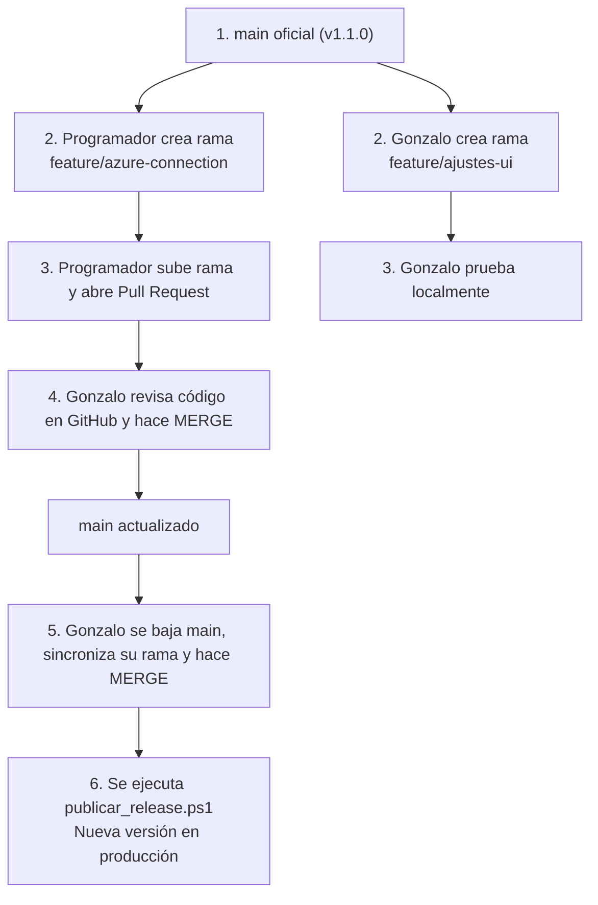

# Manual de Gobierno y Trabajo en GitHub para el Dueño del Sistema

> **Proyecto:** Homologador de Packings Externos (DDC)  
> **Perfil:** Dueño del Repositorio / Líder Técnico (Maintainer)  
> **Tecnología:** .NET 10 (WinForms + AzureApi) + SQL Server + Velopack  
> **Repositorio Oficial:** `https://github.com/Gonzaloandres1996/Homologador`

---

## 1. Filosofía de Gobierno: Tu Rol como Dueño del Proyecto

Como dueño técnico del proyecto, tu rol principal **no es escribir cada línea de código**, sino **proteger la integridad del sistema**. 

> [!IMPORTANT]
> **La regla de oro de un Tech Lead:** En producción no entra una sola línea de código que no haya pasado por tus ojos y por tu aprobación. Todo cambio debe ser explicable, trazable y verificable.

---

## 2. Gestión de Permisos y Accesos en GitHub

En un repositorio privado existen distintos niveles de permisos. Como dueño, debes aplicar el **Principio de Menor Privilegio**:

| Rol en GitHub | Qué puede hacer | A quién asignarlo |
|---|---|---|
| **Admin / Owner** | Control absoluto: borrar el repo, gestionar facturación, cambiar visibilidad y modificar reglas de seguridad. | **Únicamente tú (Gonzalo)** |
| **Write (Colaborador)** | Puede clonar, crear ramas (`branches`), subir cambios a sus ramas y abrir Pull Requests. **No puede** borrar el repositorio ni saltarse protecciones. | **El Programador / Desarrolladores externos** |
| **Read** | Solo puede ver y clonar código. No puede subir nada. | Auditores o supervisores de negocio |

### Cómo configurar los permisos del programador:
1. En GitHub, ve a tu repositorio: `https://github.com/Gonzaloandres1996/Homologador`.
2. Haz clic en la pestaña **Settings** (Configuración) $\rightarrow$ **Collaborators** (Colaboradores).
3. Busca al programador por su usuario o correo de GitHub.
4. Asígnale el rol de **`Write`**. Nunca le des rol de `Admin`.

---

## 3. Blindaje de la Rama Principal (`Branch Protection Rules`)

Para evitar accidentes (como que alguien o tú mismo hagan un `git push` directo con código sin probar a `main`), debes activar la protección de ramas en GitHub.

### Paso a paso para blindar `main`:
1. En la web de GitHub, entra a **Settings** $\rightarrow$ en el menú lateral izquierdo haz clic en **Branches**.
2. En la sección *Branch protection rules*, haz clic en **Add rule** (o *Add branch ruleset*).
3. En **Branch name pattern**, escribe: `main`.
4. Marca las siguientes casillas clave:
   - [x] **Require a pull request before merging:** Obliga a que todo cambio pase por un Pull Request. Nadie puede empujar código directo a `main`.
   - [x] **Require approvals:** Pon `1`. Exige que al menos tú revises y apruebes el código antes de que se pueda unir.
   - [x] **Dismiss stale pull request approvals when new commits are pushed:** Si apruebas un PR pero el programador sube un cambio nuevo después, se le quita la aprobación para que tengas que volver a revisar.
   - [x] **Do not allow bypassing the above settings:** Asegura que ni siquiera los administradores se salten la regla por descuido.
5. Haz clic en **Save changes**.

---

## 4. El Flujo de Trabajo Diario (GitHub Flow)

A partir de hoy, el flujo de desarrollo se resume en un ciclo de 5 fases:



### Reglas de Nomenclatura para Ramas:
* `feature/nombre-tarea`: Para funcionalidades nuevas (ej: `feature/azure-sql-auth`, `feature/reporte-rendimiento`).
* `fix/nombre-bug`: Para correcciones de errores (ej: `fix/error-formato-fecha`, `fix/timeout-conexion`).
* `refactor/modulo`: Para mejoras internas de código sin cambiar funcionalidad (ej: `refactor/limpieza-controllers`).

---

## 5. La Aduana del Dueño: Cómo Revisar un Pull Request

Cuando el programador termine su tarea, te dirá: *"Ya abrí el Pull Request en GitHub"*. En ese momento tú actúas como **Aduana de Calidad**:

### Qué revisar en GitHub (Pestaña "Files Changed"):
1. **¿Qué archivos tocó?**  
   Si la tarea era conectar Azure, no debería haber cambios en algoritmos de transformación (`TransformationEngine.cs`) ni en reglas de negocio. Si tocó archivos no relacionados, pregúntale por qué.
2. **¿Respetó el modelo de base de datos?**  
   Verifica que no haya creado columnas en conflicto con `HomologatorConfig` ni roto los identificadores numéricos (`UserId INT`).
3. **¿Agregó contraseñas o secretos en texto plano?**  
   NUNCA permitas credenciales o claves privadas escritas en el código C# o en archivos `.json`. Deben ir en `appsettings.json` local o variables de entorno.
4. **Prueba local antes de aprobar:**  
   Antes de hacer clic en *Merge*, puedes descargarte su rama a tu máquina para probarla:
   ```bash
   git fetch origin
   git checkout feature/azure-connection
   dotnet build Homologador.sln
   .\start-migracion.ps1
   ```
5. **Aprobación:** Si todo compila y funciona, en GitHub seleccionas **Review changes** $\rightarrow$ **Approve** $\rightarrow$ **Confirm merge**.

---

## 6. Publicación hacia Producción (El Ciclo de Release)

Una vez que `main` tiene los cambios aprobados y la base de datos de Azure SQL está actualizada:

1. **Te paras en `main` limpio en tu terminal:**
   ```powershell
   git checkout main
   git pull origin main
   ```
2. **Incrementas la versión** en los archivos `.csproj` (ej: pasar de `1.1.0` a `1.2.0`).
3. **Ejecutas el empaquetador automático:**
   ```powershell
   .\publicar_release.ps1 -Version "1.2.0"
   ```
4. **Resultado automático:**
   - Compila en Release `win-x64`.
   - Genera el instalador completo (`Setup.exe`) y el paquete delta ultra-liviano (`.nupkg` de pocos KB).
   - Sube los archivos a GitHub Releases y publica la versión con su etiqueta (`tag`).
   - Los operadores, al abrir el sistema, se actualizan de forma transparente.

---

## 7. Los 5 Mandamientos de Higiene Técnica

1. **`main` nunca se rompe:** Si un commit entra a `main`, DEBE compilar y pasar todas las pruebas.
2. **Los binarios no van a Git:** Jamás subas archivos `.exe`, carpetas `bin/`, `obj/` o `Release/`. Eso se gestiona exclusivamente por GitHub Releases.
3. **La Base de Datos se actualiza antes del Release:** Nunca publiques una versión de la app que requiera una tabla o columna que aún no existe en el servidor central.
4. **Commits semánticos y descriptivos:** Usa mensajes claros (`feat: agregar login azure`, `fix: corregir mapeo de productor`). Prohibido commitear con mensajes como *"cambios"*, *"arreglos"*, o *"fix"*.
5. **Nunca usar `git push --force` sobre `main`:** Destruye el historial de commits y desincroniza a los demás colaboradores.
