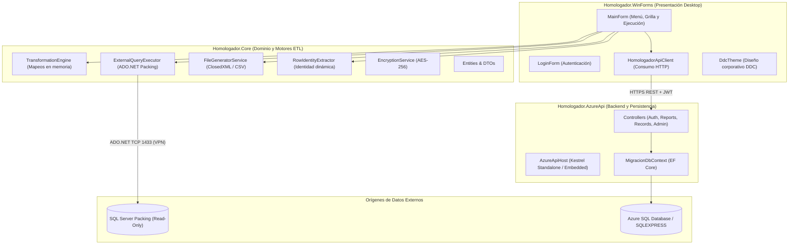
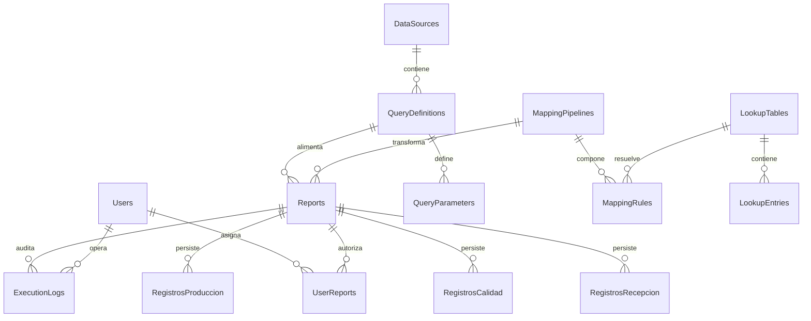
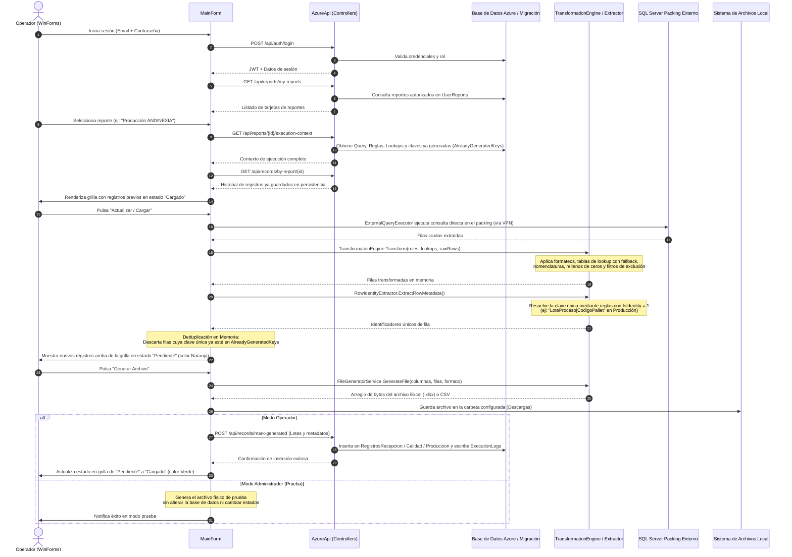

# Homologador de Cargas Masivas DDC (DataHomologator)

Sistema de extracción, transformación y homologación de datos operativos desde packings externos hacia formatos estándar de carga masiva para SAP (Recepción de Materia Prima, Calidad y Producción).

---

## 1. Descripción y Alcance del Proyecto

El **Homologador DDC** resuelve la interoperabilidad entre los sistemas informáticos heterogéneos de los packings agrícolas externos (SQL Server locales) y el ERP corporativo SAP. 

### Alcance Operativo
El sistema opera sobre **3 reportes oficiales certificados** para la operación de Andinexia:
1. **Calidad ANDINEXIA**: Homologación de análisis de calidad, tolerancias, defectos y parámetros fitosanitarios (80 reglas de mapeo).
2. **Carga Masiva SAP Recepción MP**: Homologación de recepción de fruta, productores, variedades, guías y pesajes (23 reglas de mapeo).
3. **Producción ANDINEXIA**: Homologación de procesos de embalaje, rendimientos, calibres y tarjas/pallets (19 reglas de mapeo).

### Principios de Diseño
* **Cero almacenamiento redundante**: No se almacenan copias temporales ni archivos JSON con datos del packing en la nube. La fuente de verdad operativa es la base de datos del packing y el respaldo físico es el archivo Excel/CSV generado.
* **Desacople de red**: La API de Azure nunca se conecta a las redes de los packings externos. La estación de trabajo local (con VPN activa) es la encargada de ejecutar la consulta de solo lectura mediante ADO.NET directo.
* **Determinismo e idempotencia**: El sistema rastrea de forma liviana únicamente qué identificadores ya fueron generados con estado `Cargado`, evitando duplicaciones en ejecuciones posteriores.
* **Topología resiliente**: Si la API remota en Azure no está accesible, la aplicación de escritorio levanta en el mismo proceso una instancia local de la API (`AzureApiHost`) mediante Kestrel.

---

## 2. Arquitectura de la Solución

La solución se divide en tres capas independientes dentro de `Homologador.sln` (.NET 10):



### Proyectos

* **`Homologador.WinForms`**: Aplicación de escritorio nativa en Windows Forms (.NET 10). Maneja la sesión del operador, renderizado de tarjetas de reportes asignados, grilla de resultados con diferenciación de estados (`Pendiente` / `Cargado`), configuración de carpetas de descarga y panel de administración para perfiles de TI.
* **`Homologador.Core`**: Librería de lógica pura sin dependencias de UI ni Web. Aloja los contratos DTO, las entidades de datos, el motor de transformación en memoria, la generación de archivos Excel/CSV y el extractor de identidad de lotes.
* **`Homologador.AzureApi`**: Servicio ASP.NET Core que expone endpoints REST securizados con JWT. Administra usuarios, catálogo de fuentes de datos cifradas, consultas SQL, tablas de lookups, pipelines de reglas y la persistencia de auditoría/lotes generados.

---

## 3. Base de Datos y Modelo Relacional

La base de datos relacional (`DataHomologator_Migracion`) consta de **14 tablas relacionales**, diseñada sin identificadores GUID y utilizando `INT IDENTITY(1,1)` junto a códigos formateados (`Codigo` computado persistido de 4 y 6 dígitos).



### Estructura por Bloques Funcionales

#### Bloque 1: Seguridad y Control de Acceso
* **`dbo.Users`**: Usuarios del sistema. Absorbe roles y perfiles mediante restricciones `CHECK (Rol IN ('Admin', 'Operator'))` y `CHECK (Perfil IN ('Recepción', 'Calidad', 'Producción'))`. Las contraseñas se almacenan con hash BCrypt administradas por TI.
* **`dbo.UserReports`**: Tabla de asignación muchos a muchos entre usuarios y los reportes que tienen autorizados para visualizar y ejecutar.

#### Bloque 2: Configuración de Extracción, Lookups y Pipelines ETL
* **`dbo.DataSources`**: Registro de conexiones SQL a packings externos. Almacena servidor, base de datos y credenciales cifradas con AES-256 (`UsernameEncrypted`, `PasswordEncrypted`).
* **`dbo.QueryDefinitions`**: Consultas SQL de extracción parametrizadas (vistas o stored procedures) a ejecutar contra el packing.
* **`dbo.QueryParameters`**: Parámetros tipados asociados a cada consulta SQL.
* **`dbo.LookupTables`**: Catálogo cabecera de tablas de equivalencia (mapeo de valores locales del packing a códigos SAP).
* **`dbo.LookupEntries`**: Pares clave/valor de equivalencia (`KeyValue` $\rightarrow$ `MappedValue`).
* **`dbo.MappingPipelines`**: Definición cabecera de los pipelines de transformación hacia SAP.
* **`dbo.MappingRules`**: Reglas atómicas de transformación aplicadas por columna:
  * `RuleType`: Direct, Fixed, Lookup/Homologation, DateFormat, Substring/Formatted, Computed/Conditional, Concat, Aggregate, Empty.
  * `IsIdentity`: Flag booleano que define si la columna forma parte de la clave única de deduplicación.
* **`dbo.Reports`**: Entidad integradora que asocia una consulta SQL, un pipeline de reglas, el área de negocio (`Recepción`, `Calidad`, `Producción`) y los patrones de salida de archivo.

#### Bloque 3: Persistencia de Registros Generados y Auditoría
* **`dbo.RegistrosRecepcion`**: Tabla con clave primaria `Lote` (PK natural). Almacena lotes generados con fecha, productor, kilos y estado (`Cargado`).
* **`dbo.RegistrosCalidad`**: Tabla con clave primaria `Lote` (PK natural independiente, desacoplada físicamente de Recepción para evitar bloqueos cruzados en planta).
* **`dbo.RegistrosProduccion`**: Tabla con clave primaria compuesta `(ReportId, LoteProceso, CodigoPallet)`. Permite que un mismo lote de proceso (`AN051xxxxx`) registre múltiples líneas notificadas (pallets/tarjas) sin colisión.
* **`dbo.ExecutionLogs`**: Registro histórico de cada archivo generado (filas extraídas, filas exportadas, tiempo en segundos, estado y usuario ejecutor).

---

## 4. Flujo del Sistema de Punta a Punta

El ciclo de vida completo desde la interacción del operador hasta la persistencia final sigue el siguiente flujo determinista:



### Detalle de las Etapas

1. **Extracción**: [`ExternalQueryExecutor`](src/Homologador.Core/Services/ExternalQueryExecutor.cs) abre una conexión de solo lectura (`SqlConnection`) hacia la IP/Servidor del packing externo utilizando credenciales desencriptadas al vuelo y ejecuta la consulta configurada.
2. **Transformación**: [`TransformationEngine`](src/Homologador.Core/Services/TransformationEngine.cs) procesa el conjunto de filas en memoria. Resuelve equivalencias contra diccionarios indexados `O(1)`. Si una equivalencia no se encuentra, emite una advertencia de auditoría y aplica **Fallback** manteniendo el dato original para evitar pérdida de trazabilidad.
3. **Identidad Dinámica**: [`RowIdentityExtractor`](src/Homologador.Core/Services/RowIdentityExtractor.cs) inspecciona las reglas del pipeline que tengan `IsIdentity = 1`. En Producción, combina de forma dinámica el lote de proceso con el código de tarja/pallet (`LOTEPROCESO|CODIGO PALLET`), permitiendo que coexistan múltiples registros para un mismo lote sin código en duro.
4. **Deduplicación**: Se contrasta cada clave contra el conjunto de claves ya exportadas (`AlreadyGeneratedKeys`). Solo las filas genuinamente nuevas se presentan al operador como `Pendiente`.
5. **Generación Físico**: [`FileGeneratorService`](src/Homologador.Core/Services/FileGeneratorService.cs) serializa las filas aprobadas a OpenXML nativo (`.xlsx`) mediante ClosedXML o texto delimitado (`.csv`) según el formato del reporte.
6. **Persistencia y Cierre**: Al confirmar la exportación, la API guarda los registros en su respectiva tabla relacional (`RegistrosRecepcion`, `RegistrosCalidad` o `RegistrosProduccion`) y genera la entrada correspondiente en `ExecutionLogs`.

---

## 5. Requisitos y Puesta en Marcha

### Prerrequisitos
* **.NET 10 SDK** (Runtime Windows Desktop).
* **Microsoft SQL Server** (Local `.\SQLEXPRESS` o Azure SQL Database).
* Acceso de red / VPN a las bases de datos de los packings externos.

### Inicialización de la Base de Datos
1. Abrir SQL Server Management Studio (SSMS).
2. Ejecutar el script [`02_Crear_BD_Simplificada_SSMS.sql`](02_Crear_BD_Simplificada_SSMS.sql).
   * Crea la base de datos `DataHomologator_Migracion`.
   * Inicializa las 14 tablas relacionales.
   * Migra y parametriza los 3 reportes oficiales, sus 3 pipelines y las 122 reglas activas.
   * Crea los usuarios por defecto con contraseña administrativa (`admin123.`).

### Ejecución
Compilar y ejecutar la solución:
```powershell
# Compilación
dotnet build Homologador.sln

# Ejecución de la aplicación de escritorio
dotnet run --project src/Homologador.WinForms/Homologador.WinForms.csproj
```
