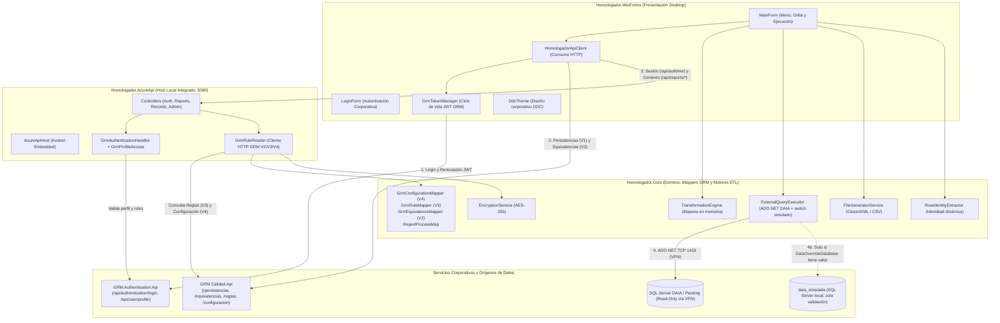
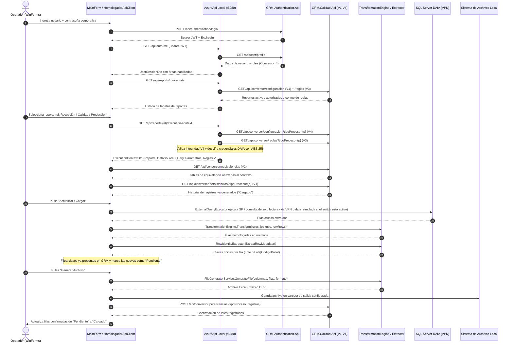

# Homologador de Cargas Masivas DDC (DataHomologator)

Sistema de extracción, transformación y homologación de datos operativos desde packings externos hacia formatos estándar de carga masiva para SAP (Recepción de Materia Prima, Calidad y Producción), integrado con los servicios corporativos de **GRM en Azure**.

**Versión actual:** `1.3.0`

---

## 0. Estado del Proyecto

| Ítem | Estado |
| :--- | :--- |
| Integración GRM V1–V4 (autenticación, persistencias, equivalencias, reglas y configuración) | Completa y operativa |
| Suite de verificación automatizada | 96 checks aprobados, build Release sin errores ni advertencias |
| Switch de origen DAIA hacia base simulada (`daia_simulada`) | Disponible y desactivado por defecto (`DaiaOverrideDatabase = ""`) |
| Validación de archivos generados contra SAP | En curso, fuera del Homologador, usando datos de la base simulada |
| Persistencias en GRM durante la validación | Administradas directamente en Azure (carga y borrado de registros) junto al equipo de GRM |
| **Corte productivo** | **9 de noviembre de 2026**: limpieza de datos de validación y salida a producción |

> **Antes del corte:** confirmar que `DaiaOverrideDatabase` esté vacío en `src/Homologador.AzureApi/appsettings.json` y que las persistencias de validación hayan sido eliminadas en GRM.

---

## 1. Descripción y Alcance del Proyecto

El **Homologador DDC** resuelve la interoperabilidad entre los sistemas informáticos heterogéneos de los packings agrícolas externos (SQL Server en planta/DAIA) y el ERP corporativo SAP.

### Alcance Operativo
El sistema opera sobre **3 reportes oficiales certificados** para la operación de packings externos:
1. **Calidad Andinexia** (`ReportId = 1`, `TipoProceso = 2`, `Pipeline = 1`): Homologación de análisis de calidad, tolerancias, defectos y parámetros fitosanitarios.
2. **Recepciones 26-10** (`ReportId = 2`, `TipoProceso = 1`, `Pipeline = 3`): Homologación de recepción de fruta, productores, variedades, guías y pesajes hacia formato SAP.
3. **Pipeline SAP Producción** (`ReportId = 3`, `TipoProceso = 3`, `Pipeline = 2`): Homologación de procesos de embalaje, rendimientos, calibres y tarjas/pallets hacia formato SAP.

### Principios de Diseño
* **Gobierno centralizado en GRM (V1–V4)**: La autenticación, los permisos por área, las tablas de equivalencias, las reglas de mapeo, la configuración de consultas/orígenes de datos y el registro histórico de lotes generados residen de forma centralizada en las APIs corporativas de GRM en Azure (`GRM.Authentication.Api` y `GRM.Calidad.Api`), eliminando la necesidad de instalar o mantener bases SQL Server locales (`HomologatorConfig`) en las estaciones de trabajo.
* **Cero almacenamiento redundante de payloads**: No se almacenan copias temporales ni archivos JSON con datos crudos del packing en la nube. La fuente de verdad operativa es la base de datos de origen (DAIA) y el respaldo físico es el archivo Excel/CSV generado.
* **Desacople de red hacia DAIA**: Las APIs en Azure nunca abren conexión directa hacia las redes internas de los packings externos. La estación de trabajo del operador (con VPN/red corporativa activa) descifra en memoria las credenciales recibidas desde GRM V4 mediante AES-256 (`EncryptionService`) y ejecuta la consulta de solo lectura mediante ADO.NET directo.
* **Determinismo e idempotencia**: El sistema rastrea en GRM (`api/conversor/persistencias`) únicamente qué identificadores (`Lote` o `Lote|CodigoPallet`) ya fueron generados con estado `Cargado`, evitando duplicaciones en ejecuciones posteriores.
* **API local integrada**: Al iniciar, la aplicación de escritorio levanta en el mismo proceso una instancia local de `Homologador.AzureApi` (`http://localhost:5080`) mediante Kestrel si no detecta otra instancia activa y compatible.

---

## 2. Arquitectura de la Solución

La solución se organiza en cuatro proyectos dentro de `Homologador.sln` (.NET 10):



### Proyectos

* **`Homologador.WinForms`**: Aplicación de escritorio en Windows Forms (.NET 10) con actualización automática vía Velopack. Gestiona el inicio de sesión corporativo con GRM, el renderizado de reportes autorizados según el perfil del usuario, la grilla de resultados (`Pendiente` / `Cargado`) y la exportación de archivos. Copia `appsettings.json` de `Homologador.AzureApi` a su directorio de salida.
* **`Homologador.Core`**: Librería de dominio y motores ETL sin dependencias de UI ni Web. Contiene las entidades, contratos DTO, los mappers de integración GRM (`GrmConfigurationMapper`, `GrmRuleMapper`, `GrmEquivalenceMapper`, `ReportProcessMap`), el motor de transformación en memoria, el servicio de cifrado AES-256, la generación de archivos Excel/CSV, el extractor de identidad de filas y el switch de origen DAIA.
* **`Homologador.AzureApi`**: Host ASP.NET Core embebido en el puerto local `5080`. Valida tokens y perfiles contra `GRM.Authentication.Api`, orquesta la lectura de configuración V4 y reglas V3 desde `GRM.Calidad.Api`, descifra credenciales de orígenes de datos con `EncryptionService` y expone los contratos REST consumidos por el cliente WinForms.
* **`Homologador.Security.Checks`**: Suite ejecutable de 96 verificaciones automatizadas (`Program.cs` y `V4Checks.cs`) que comprueba de extremo a extremo la seguridad de tokens, permisos por área, persistencias (V1), equivalencias (V2), reglas (V3), configuración sin base SQL local (V4) y el arranque seguro de la API local.

---

## 3. Integración con Servicios Corporativos GRM (Fases V1 a V4)

La arquitectura reemplaza las antiguas bases SQL Server locales (`HomologatorConfig` y el uso operativo de `HomologatorAzure`) por cuatro contratos sobre las APIs corporativas de GRM en Azure:

| Fase | Componente / Endpoint GRM | Responsabilidad Funcional | Clases Responsables |
| :--- | :--- | :--- | :--- |
| **V1 (Autenticación y Persistencias)** | `GRM.Authentication.Api` (`/api/authentication/login`, `/api/user/profile`) y `GRM.Calidad.Api` (`GET/POST /api/conversor/persistencias?tipoProceso=1\|2\|3`) | Inicio de sesión con credenciales corporativas, autorización por roles (`Conversor_Recepcion`, `Conversor_Calidad`, `Conversor_Produccion`) y lectura/registro de lotes generados por proceso. | `GrmTokenManager`, `GrmAuthenticationHandler`, `GrmProfileAccess`, `HomologadorApiClient` |
| **V2 (Equivalencias / Lookups)** | `GRM.Calidad.Api` (`GET /api/conversor/equivalencias`) | Obtención dinámica de las tablas de homologación (`idParametro`: `2=Especies`, `3=Esponjas`, `4=Polvo Tierra`, `5=Tratamiento`). | `GrmEquivalenceMapper`, `HomologadorApiClient`, `GrmRuleReader` |
| **V3 (Reglas de Transformación)** | `GRM.Calidad.Api` (`GET /api/conversor/reglas?tipoProceso=1\|2\|3`) | Obtención ordenada de las reglas de mapeo (`Valor1` a `Valor14`) para cada reporte y pipeline sin límites fijos de cantidad de reglas. | `GrmRuleMapper`, `ReportProcessMap`, `GrmRuleReader` |
| **V4 (Configuración y Orígenes DAIA)** | `GRM.Calidad.Api` (`GET /api/conversor/configuracion[?tipoProceso=1\|2\|3]`) | Reconstrucción en memoria de `Reports`, `QueryDefinitions`, `QueryParameters` y `DataSources` (`idAplicacion = 2`), validando integridad referencial y descifrando localmente las credenciales de conexión a DAIA con `EncryptionService`. | `GrmConfigurationContracts`, `GrmConfigurationMapper`, `GrmRuleReader`, `ReportsController` |

### Notas sobre Seguridad y Gobierno Administrativo
* **Descifrado local de credenciales DAIA**: GRM almacena y transmite las credenciales de `DataSources` cifradas (`CfgUsernameEncrypted`, `CfgPasswordEncrypted`). El descifrado ocurre exclusivamente en memoria dentro de la estación de trabajo mediante la clave AES configurada en `appsettings.json` (`Encryption:Key`), sin exponer textos cifrados ni claves en mensajes de error o diagnósticos.
* **Sin fallback silencioso a SQL local**: Ante cualquier fallo de red, timeout o incoherencia en los datos devueltos por GRM, la API local rechaza la operación con códigos HTTP explícitos (`401`, `403`, `502`, `503`) sin recurrir a bases de datos locales.
* **Arranque seguro de la API local**: Antes de reutilizar una API ya activa en el puerto `5080`, el cliente exige que `/api/health` informe `authentication = "GRM"` y `configDb = "GRM"`. Cualquier API antigua que dependa de `HomologatorConfig` es rechazada con un mensaje explícito para que sea cerrada.
* **Rutas heredadas bloqueadas**: La política `HomologadorAdmin` se encuentra deshabilitada por diseño (`RequireAssertion(_ => false)`) y las rutas locales de persistencia en `RecordsController` responden `HTTP 410 Gone`, dado que toda la administración y persistencia se gobierna desde GRM. `HomologatorAzure` solo conserva esos accesos administrativos heredados y no es necesaria para operar.

---

## 4. Switch de Origen DAIA (Base Simulada)

`ExternalQueryExecutor.BuildConnectionString` aplica un override opcional sobre la conexión DAIA entregada por GRM V4. Se controla con tres claves de `src/Homologador.AzureApi/appsettings.json`:

```json
"DaiaOverrideDatabase": "",
"DaiaOverrideServer": ".\\SQLEXPRESS",
"DaiaOverrideTrustedConnection": true
```

| `DaiaOverrideDatabase` | Comportamiento |
| :--- | :--- |
| `""` (vacío o solo espacios) | **Producción.** No se modifica nada: se usa el servidor, base y credenciales de DAIA recibidos desde GRM V4. `DaiaOverrideServer` y `DaiaOverrideTrustedConnection` se ignoran. |
| `"daia_simulada"` | **Validación.** Reemplaza la base por `daia_simulada`, el servidor por `DaiaOverrideServer` y, si `DaiaOverrideTrustedConnection = true`, usa autenticación integrada de Windows descartando usuario y contraseña. |

* El archivo se lee en cada extracción, por lo que el cambio aplica al pulsar **Actualizar** sin reiniciar la aplicación.
* La búsqueda de `appsettings.json` prioriza `src/Homologador.AzureApi/appsettings.json` subiendo desde el directorio de ejecución; luego el `appsettings.json` junto al ejecutable y finalmente el del directorio de trabajo.
* Si el archivo no existe o está mal formado, el override se ignora y se mantiene la conexión de GRM V4.
* La base `daia_simulada` debe existir en la instancia indicada y respetar el mismo contrato que DAIA productiva (vistas, stored procedures, parámetros y nombres de columnas).

> [!WARNING]
> Con el override activo, las filas extraídas de `daia_simulada` se tratan como datos reales: se habilita **Generar Archivo** y se registran persistencias mediante `POST /api/conversor/persistencias` en GRM. Usar el switch solo en estaciones de validación y eliminar en GRM las persistencias de prueba antes del corte productivo.

> [!IMPORTANT]
> `appsettings.json` se incluye en el paquete publicado por Velopack. Todo release debe generarse con `DaiaOverrideDatabase = ""`.

---

## 5. Flujo del Sistema de Punta a Punta



> Si no hay conexión con el servidor DAIA (VPN inactiva), la aplicación ofrece simular 3 lotes para validar el pipeline. Esas filas se muestran como `Pendiente` y no habilitan **Generar Archivo** ni registran persistencias en GRM para operadores.

---

## 6. Requisitos, Ejecución y Pruebas

### Prerrequisitos
* **Windows x64** compatible con **.NET 10** y **.NET 10 SDK**.
* **Conectividad HTTPS** hacia los servicios corporativos de GRM en Azure.
* **Conectividad de red / VPN** hacia el servidor SQL Server de origen (**DAIA**) con los mismos permisos de red del entorno operativo.
* **No se requiere SQL Server local** para operar: no es necesario instalar SQL Server Express ni restaurar las bases `HomologatorConfig` o `HomologatorAzure`. Solo las estaciones de validación que usen el switch necesitan una instancia local con `daia_simulada`.
* **Preservación de `appsettings.json`**: No modificar ni eliminar `Encryption:Key` en `src/Homologador.AzureApi/appsettings.json`, ya que se utiliza para descifrar las credenciales de `DataSources` entregadas por GRM V4.
* **Acceso a NuGet** (o paquetes en caché) para `dotnet restore`.

### Compilación y Ejecución
Abrir PowerShell en la raíz del repositorio y ejecutar:

```powershell
dotnet restore
dotnet build Homologador.sln -c Release
dotnet run --project src\Homologador.WinForms\Homologador.WinForms.csproj
```

También puede usarse el lanzador incluido:

```powershell
powershell -NoProfile -ExecutionPolicy Bypass -File .\start-migracion.ps1
```

> **Notas operativas:**
> * Ambos comandos inician la interfaz WinForms y levantan automáticamente la API local integrada en `http://localhost:5080`. No iniciar `Homologador.AzureApi` por separado y verificar que no exista una instancia previa ocupando el puerto `5080`.
> * El primer arranque compila la solución y puede demorar alrededor de 30 segundos sin mostrar ventana.
> * El banner de `start-migracion.ps1` conserva un texto histórico sobre `HomologatorConfig` y `HomologatorAzure`; el script solo ejecuta el proyecto WinForms.
> * Si la carpeta proviene de un archivo descargado o comprimido, ejecutar `Get-ChildItem -Recurse | Unblock-File` para que Windows permita ejecutar el script.

### Ejecución de la Suite de Verificación Automatizada (96 Checks)
Para validar la seguridad, autenticación, persistencias (V1), equivalencias (V2), reglas (V3), configuración (V4) y el arranque seguro de la API local sin afectar datos de producción en GRM ni consultar DAIA:

```powershell
dotnet run --project tests\Homologador.Security.Checks\Homologador.Security.Checks.csproj -c Release
```

Las verificaciones usan respuestas HTTP controladas, no escriben en GRM PROD ni consultan DAIA.

### Publicación de Nuevas Versiones (Velopack + GitHub Releases)
El sistema cuenta con actualización automática mediante **Velopack** apuntando a los *GitHub Releases* del repositorio oficial. Para generar y publicar una nueva versión hacia los operadores:

1. Actualizar `<Version>` en los `.csproj` de `src/` (la versión debe ser mayor a la última publicada; Velopack no instala versiones inferiores).
2. Confirmar que `DaiaOverrideDatabase` esté vacío en `src/Homologador.AzureApi/appsettings.json`.
3. Fusionar a `main` y ejecutar:

```powershell
.\publicar_release.ps1 -Version "1.3.0" -GitHubToken "<TU_TOKEN_GITHUB>"
```
